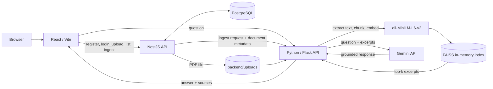
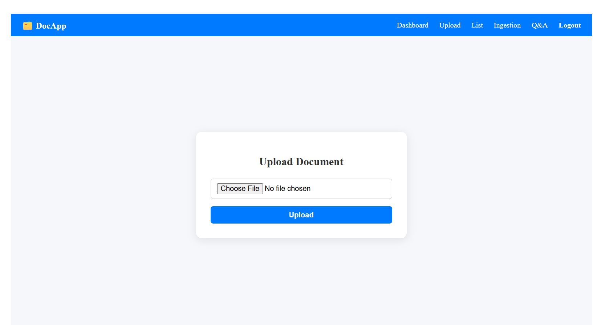
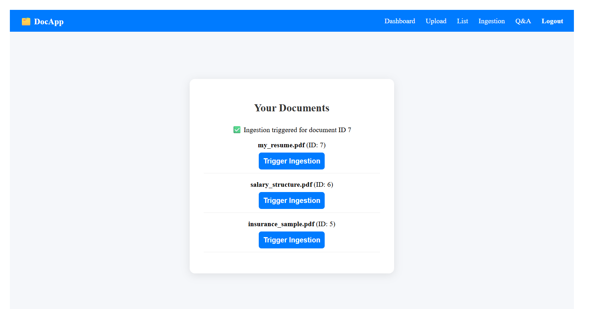

# PDF Knowledge Assistant

A prototype web application for uploading PDFs, retrieving relevant passages,
and generating a document-grounded answer. The UI is React, the application API
is NestJS, metadata is stored in PostgreSQL, and a Python service handles PDF
ingestion, vector retrieval, and LLM calls.

> **Scope:** This prototype answers questions from indexed PDFs. It is not a
> production-ready or user-isolated document service.

## What works

- Register and log in using the NestJS API; passwords are hashed and JWTs are
  issued.
- Upload PDFs. The original filename is kept as metadata while a unique name is
  used on disk to avoid overwriting files with the same name.
- List a user's documents and trigger PDF ingestion.
- Extract PDF text, split it into chunks, create embeddings, and retrieve the
  nearest passages for a question.
- Send retrieved excerpts to Google Gemini through its OpenAI-compatible API
  and display a generated answer with source filenames and excerpts.
- Run the Python LLM logic and API error handling through unit tests.

## Architecture



In local development, Node and Python share the same `backend/uploads` folder.
The browser sends Q&A requests directly to Python; upload, login, and document
management requests go to NestJS. The vector index is rebuilt in memory when
ingestion runs and is not persisted.

## RAG and LLM decisions

- **Chunking:** PDF text is split into fixed 500-character chunks without
  overlap. This was a simple starting point; it can split sentences and has not
  been evaluated against alternative sizes or semantic chunking.
- **Embedding model:** `all-MiniLM-L6-v2` from Sentence Transformers is used
  locally to embed both chunks and questions. It avoids sending embedding text
  to another hosted service, but quality has not been benchmarked on a labeled
  question set.
- **Vector search:** FAISS `IndexFlatL2` searches the in-memory vectors and
  returns the configured `RETRIEVAL_TOP_K` (default 3). The index is exact and
  small/simple, but rebuilds on ingestion/restart and does not scale or persist
  like a managed vector database.
- **LLM:** the working local configuration uses Gemini via Google's
  OpenAI-compatible endpoint. The OpenAI Python client is used as a compatible
  transport; the configured model and endpoint are environment settings. An
  OpenAI API configuration was also tried, but the account had no API credits.
  Ollama was considered but was not suitable for this machine; Hugging Face's
  hosted inference free tier did not include credits for a free account when
  checked.
- **Context and prompt:** each request includes the question and the top
  retrieved excerpts with filenames. The system prompt tells the model to use
  only those excerpts, treat excerpt text as untrusted input, abstain when the
  evidence is insufficient, and cite filenames. There is no retained
  conversation history, reranker, or orchestration framework.
- **Guardrails and quality:** the prompt is a best-effort instruction, not a
  security boundary. Citations are not automatically verified and answers are
  not fact-checked. A curated evaluation set, retrieval metrics, citation
  checks, and human review remain future work.
- **Privacy:** questions and retrieved excerpts are sent to the configured
  Gemini service. Review Google's current terms and do not use confidential
  documents unless their use is approved.

## Engineering practices and AI assistance

- Backend logic is separated into NestJS modules/controllers/services; document
  metadata is represented by TypeORM entities.
- Passwords are hashed, API keys are kept in an ignored local `.env`, and LLM
  provider failures are returned as explicit API errors.
- Tests cover the backend document service and Python answer generation/API
  error handling. The Python LLM tests mock the provider; they do not prove
  provider availability.
- GitHub Copilot was used during development to help inspect and implement
  code. Suggestions were reviewed and the relevant builds/tests were run. AI
  output was not treated as verified without checking it. Before submission,
  add your own specific account of how you used/reviewed AI suggestions.

### Standards intentionally not completed

- The frontend TypeScript production build currently fails with errors in
  `frontend/src/main.tsx` and its JSX imports. `npx vite build` succeeds, but
  that is not a replacement for fixing the type-check.
- No end-to-end test covers upload → ingestion → question → answer. There is no
  automated retrieval-quality benchmark, CI pipeline, structured metrics, or
  tracing.
- TypeORM schema synchronization is enabled for development instead of using
  database migrations.
- Upload type/size validation and per-user filtering in Q&A are incomplete.

## Screenshots and demo

Add your screenshots to `docs/screenshots/` using these filenames, then the
image links below will display them in this README:

1. `docs/screenshots/01-upload.png` — document upload page.
2. `docs/screenshots/02-documents-and-ingestion.png` — uploaded document and
   ingestion action/status.
3. `docs/screenshots/03-question-and-answer.png` — a question, generated
   answer, and its source excerpts.

Optional: add `docs/demo-link.md` with your Loom URL. Do not include API keys,
tokens, private documents, or other sensitive information in screenshots/video.

<!-- Uncomment each image after adding the corresponding screenshot file.



-->

## Local setup (Windows PowerShell)

### Prerequisites

- Node.js and npm
- Python 3.12 (the version used for Python tests in this environment; a Python
  version with compatible `faiss-cpu` wheels is required)
- PostgreSQL
- A Gemini API key from [Google AI Studio](https://aistudio.google.com/apikey)

### 1. Configure the backend

Create a PostgreSQL database, then create `backend/.env` from the example if
you do not already have one. Set the PostgreSQL connection values and replace
the example JWT secret with a private value. If `backend/.env` already exists,
edit it rather than overwriting it.

```powershell
cd E:\xampp\htdocs\fullstack-rag\backend
if (-not (Test-Path .env)) { Copy-Item .env.example .env }
npm install
npm run start:dev
```

The backend listens on `http://localhost:3000`. TypeORM schema synchronization
is enabled for development; production should use migrations.

### 2. Configure and run the Python API

Create the project-root `.env` from `.env.example` if it does not already
exist, then set `LLM_API_KEY` to your Gemini API key. If `.env` already exists,
edit it without replacing the key or other settings. Keep this file local; it
is ignored by Git.

```powershell
cd E:\xampp\htdocs\fullstack-rag
if (-not (Test-Path .env)) { Copy-Item .env.example .env }
notepad .env

cd E:\xampp\htdocs\fullstack-rag\rag-api
py -3.12 -m venv .venv
.\.venv\Scripts\Activate.ps1
python -m pip install -r requirements.txt
python app.py
```

The API listens on `http://localhost:5000`. On first startup, the embedding
model may need to download. The root `.env.example` defaults to Gemini; its
settings are:

| Variable | Purpose | Default |
| --- | --- | --- |
| `LLM_API_KEY` | Gemini API key | Set locally; never commit |
| `LLM_MODEL` | Model ID | `gemini-3.8-flash` |
| `LLM_BASE_URL` | OpenAI-compatible provider endpoint | `https://generativelanguage.googleapis.com/v1beta/openai/` |
| `LLM_TEMPERATURE` | Generation randomness | `0.2` |
| `LLM_MAX_TOKENS` | Maximum answer tokens | `500` |
| `LLM_TIMEOUT_SECONDS` | Provider request timeout | `45` |
| `RETRIEVAL_TOP_K` | Retrieved passages to include | `3` |

Model names and free-tier availability/quotas can change; check AI Studio if a
model is unavailable. The project `.env` is separate from `backend/.env`.

### 3. Run the frontend

```powershell
cd E:\xampp\htdocs\fullstack-rag\frontend
npm install
npm run dev
```

Open the Vite URL (normally `http://localhost:5173`). Configure the backend
database and start NestJS, Python, and the frontend in separate terminals.
Upload a PDF, trigger ingestion, then ask a question.

### Tests

```powershell
cd E:\xampp\htdocs\fullstack-rag\backend
npm test -- --runInBand

cd E:\xampp\htdocs\fullstack-rag\rag-api
py -3.12 -m unittest discover -s tests -v
```

## What does not work yet / known limitations

- Only PDFs are extracted and indexed. The upload page also accepts DOC/DOCX,
  but the Python indexer does not process them. Scanned PDFs need OCR.
- All ingested PDFs form one shared in-memory search index. Q&A is not
  authenticated or isolated by user; the frontend currently sends a hard-coded
  user ID that is not used for retrieval.
- Ingestion rebuilds the whole index synchronously. An API restart loses the
  index until ingestion runs again.
- The frontend `npm run build` type-check fails, and Docker deployment has not
  been verified. The Compose setup has no PostgreSQL service/database
  configuration, and the frontend Dockerfile expects `/app/build` although Vite
  emits `/app/dist`.
- No retries/backoff, rate/cost controls, LLM output schema validation,
  citation verification, OCR, or production observability are implemented.
- Gemini free-tier limits can change or be exhausted. The application cannot
  generate an answer when the configured provider is unavailable.

## Productionization and scaling plan

For example, on AWS I would:

1. Store PDFs in private S3 instead of a shared local folder, using short-lived
   upload/download URLs and encryption.
2. Run the frontend behind CloudFront and deploy the NestJS and Python APIs as
   separate ECS/Fargate services behind an application load balancer.
3. Use RDS PostgreSQL with migrations. Store vectors in `pgvector` or a managed
   vector database after evaluating query quality and scale; do not rely on an
   in-memory FAISS index across replicas.
4. Put ingestion on SQS with worker processes, retries, idempotency, and
   per-document status so uploads are not blocked by embedding work.
5. Add authenticated, tenant-scoped retrieval and enforce file ownership in
   every query. Keep provider/database credentials in Secrets Manager and apply
   least-privilege IAM.
6. Add rate limits, file-size/type validation, malware scanning, retention
   rules, audit logs, dashboards, traces, and alerts using CloudWatch/OpenTelemetry.
7. Benchmark chunk sizes, embedding/reranking choices, and `k` on representative
   questions. Track retrieval recall (for example Recall@k), citation support,
   answer correctness, latency, and cost before changing models or scaling.

Equivalent managed storage, database/vector search, queue, secrets, and
container services can be selected on GCP or Azure. This deployment plan is
proposed work, not an implemented or tested cloud deployment.
